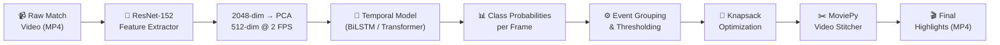

# ⚽ MatchCut AI

[](https://matchcut-ai.streamlit.app)

**Live Demo:** [https://matchcut-ai.streamlit.app](https://matchcut-ai.streamlit.app)

**Why wait for the broadcast? AI-Powered Match Highlights in Seconds.**

An end-to-end deep learning pipeline that automatically generates highlight reels from full-length football match videos. The system detects key events — **Goals, Cards, and Substitutions** — using temporal models trained on the [SoccerNet](https://www.soccer-net.org/) dataset, then stitches the best clips into a compact highlight video using a Knapsack optimization algorithm.

---

## 🚀 Quick Start (Streamlit App)

The easiest way to use MatchCut AI is through the local Streamlit dashboard.

1. **Install Dependencies:**
   ```bash
   pip install -r requirements.txt
   ```
2. **Model Checkpoints:**
   `checkpoints/CNN_BiLSTM_best.pth` (used by the app) and `checkpoints/CNN_Baseline_best.pth` (baseline for comparison) are included. The Transformer checkpoint is not included; it underperformed (see `results/metrics_summary.json`).
3. **Run the App:**
   ```bash
   streamlit run app.py
   ```
4. **Generate Highlights:**
   Open the local web URL, upload a `.mp4` football match video, and the AI will automatically extract features and generate a highlight reel!

`Football_Highlight_Detection.py` is the full training/inference pipeline (Colab-style script); `demo_highlights.mp4` is a sample output highlight reel.

---

## 🏗️ System Architecture



### Two-Stage Design

| Stage | Component | Purpose |
|---|---|---|
| **Spatial** | ResNet-152 + PCA | Extracts 2048-dim features, reduced to 512 via PCA (matching SoccerNet's pipeline) |
| **Temporal** | BiLSTM | Understands sequences of frames (is a goal being scored over these 30 frames?) |
| **Selection** | 0/1 Knapsack (DP) | Picks the best combination of events that fits within a time budget |
| **Output** | MoviePy Stitcher | Cuts and concatenates video clips into the final highlight reel |

---

## 📊 Results

Three architectures were trained and compared on the SoccerNet Action Spotting benchmark (60-match subset):

| Model | Test Accuracy | Test mAP | Val mAP (Best) | Epochs |
|---|---|---|---|---|
| CNN Baseline (FC layers) | 89.1% | 12.7% | 10.2% | 20 |
| **CNN + BiLSTM** | **96.3%** | **35.1%** | **38.4%** | 23 |
| CNN + Transformer | 93.9% | 8.9% | 10.3% | 18 |

> **Key Finding:** The BiLSTM architecture significantly outperforms both the baseline and the Transformer on this dataset size, achieving **35.1% mAP** — approximately half of the state-of-the-art (~70% mAP) while using only **12% of the training data** and a single free-tier Google Colab GPU.

### Training Curves

| Loss Curves | Validation mAP | Confusion Matrices |
|---|---|---|
|  |  |  |

| Model Comparison | Event Timeline |
|---|---|
|  |  |

---

## ⚙️ Technical Details

### Hyperparameters

| Parameter | Value | Rationale |
|---|---|---|
| Feature Dimension | 512 | ResNet-152 (2048-dim) reduced to 512 via PCA |
| Sequence Length | 30 frames | 15 seconds of context at 2 FPS |
| Target FPS | 2 | Standard for SoccerNet temporal analysis |
| BiLSTM Hidden Size | 256 | Balance between capacity and overfitting |
| Dropout | 0.4 | Regularization for small dataset |
| Learning Rate | 5e-4 | Adam optimizer with ReduceLROnPlateau |
| Class Weights | Inverse frequency | Handles severe class imbalance (95%+ Background) |

---

## 🛠️ Built With

- **PyTorch** — Deep learning framework
- **Streamlit** — Web application framework
- **torchvision** — ResNet feature extraction
- **MoviePy** — Video editing and stitching
- **OpenCV** — Frame-level video processing
- **SoccerNet** — Dataset and evaluation API
- **scikit-learn** — Metrics (mAP, confusion matrix)

---

## 📜 References

1. Giancola, S., et al. *"SoccerNet: A Scalable Dataset for Action Spotting in Soccer Videos."* CVPR Workshops, 2018.
2. Deliège, A., et al. *"SoccerNet-v2: A Dataset and Benchmarks for Holistic Understanding of Broadcast Soccer Videos."* CVPR Workshops, 2021.
3. He, K., et al. *"Deep Residual Learning for Image Recognition."* CVPR, 2016.
4. Apostolidis, E., et al. *"CA-SUM: Combining Attentive and Non-Attentive Summarization."* ECCV, 2022.
